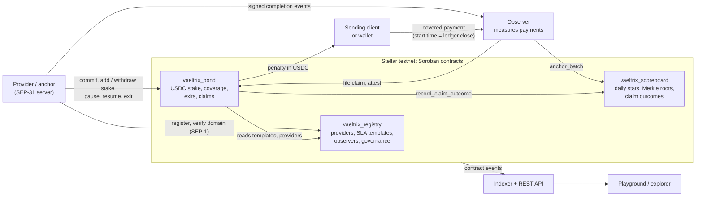

# Vaeltrix

Vaeltrix is a protocol on Stellar where anchors and payment providers stake USDC against public payout-time guarantees. When a covered SEP-31 payout lands late, or never, the sender is paid a penalty from that stake automatically. Every outcome feeds a public reliability scoreboard per provider and corridor.

- **Live on testnet:** three Soroban contracts, with 1,000 test USDC staked in commitment 1
- **Playground:** https://vaeltrix-testnet.vercel.app
- **Website:** https://www.vaeltrix.xyz
- **Contract and transaction links:** [`test-net-deployment.md`](test-net-deployment.md)
- **License:** Apache-2.0

## Why it exists

Stellar settles a cross-border payment in seconds. The slow part is the receiving anchor's payout to a bank account or mobile money wallet, which happens offchain and can take minutes or a full day. SEP-31 lets an anchor publish a `status_eta`, but nothing holds it to that estimate, service terms live in private agreements, and stalled payments end up as support tickets.

Vaeltrix makes payout time measurable and enforceable:

1. A provider commits to a standard SLA template (for example, a 60-minute bank payout) and locks USDC stake in the bond contract.
2. Each covered payment is timed from the ledger close of its Stellar transaction to the provider's signed completion event.
3. If the payout breaches the target, a claim is filed, checked by an independent observer, and the penalty is paid from the provider's stake to the sender.
4. Observers publish daily statistics with a Merkle root, so anyone can recompute every provider's on-time rate.

## How it fits together



Funds only ever sit in `vaeltrix_bond`, and stake can only leave to a sender on an upheld claim or back to the provider after the exit cooldown. The registry and scoreboard hold no funds.

## What is built

| Part | Status | Details |
| --- | --- | --- |
| `vaeltrix_registry` | Built, deployed, 26 tests | Provider registration bound to a home domain, signer rotation, domain verification by a separate verifier role, suspension. Versioned SLA templates that activate after a timelock. Observer set, parameters and upgrades change only through a timelocked governance queue, with observer and provider roles kept independent. Two-step admin handover. |
| `vaeltrix_bond` | Built, deployed, 16 tests | `commit` checks the provider is active and verified, the asset matches the template, and stake covers both the minimum and the template's maximum penalty. Stake top-ups and excess withdrawals that never drop below minimum plus reserved stake. Pause and resume with time-aware coverage checks. Exit with a frozen cooldown, blocked while claims are open. Timelocked upgrades. |
| `vaeltrix_scoreboard` | Built, deployed, 10 tests | `anchor_batch` accepts daily statistics only from active observers and rejects duplicates, future or misaligned periods and counts that do not add up. Lifetime totals per provider. `record_claim_outcome` callable only by the bond contract. |
| `vaeltrix-types` | Built | Frozen data model, error codes, ID derivation, cross-contract client interfaces. |
| `vaeltrix-verdict` | Built | Pure, overflow-safe SLA rules (on time, late, no completion, carve-out pauses, penalty, claim bond, minimum stake, exit cooldown), checked against test vectors shared with TypeScript. |
| Playground | Live | Reads deployed state with no wallet. With Freighter on testnet: register a provider, commit stake, add or withdraw stake, pause and resume. |
| Database and API foundation | Built | 14-table Postgres schema and a read-only Fastify API serving `/healthz` and `/v1/openapi.json`. |
| Deploy and seed scripts | Built | Deploy registry, scoreboard and bond, wire them together, and seed template 901 with a demo provider and commitment. |
| Claim functions in `vaeltrix_bond` | Next | File, challenge, attest, resolve, expire and pay out. The data model and error codes are already frozen. |
| Observer, indexer, API endpoints, SDK, mock anchor | Next | Scaffolded with their module layout. |
| Smoke test, domain verification script, demo scripts | Next | Wired in `package.json`, not implemented yet. |

## Testnet deployment

| Contract | ID |
| --- | --- |
| `vaeltrix_registry` | `CBBZQ577QYKADNBAYBYN56Q3ZDTDQYCBOGREHBFEVOWOI5F27TJBE6MO` |
| `vaeltrix_bond` | `CCYLDMTA4CTFF2VHULUCCBNCBMN3G7MA33EZ2OFYMIRSIKX3PYUHCUAI` |
| `vaeltrix_scoreboard` | `CD4TA5VDQUHF2LV5H5LWQSXRUSWTQYZN23MONYYUZQAJ5JBOEGYAP5EC` |
| Test USDC | `CB2CFWENJ2M5JXWBGUOKO75QVIFJ2EY5WOIOHR6FFYTXAKGS2S3XOIM4` |

Wasm hashes, deployment transactions and account roles are in [`deployments/testnet.json`](deployments/testnet.json). Explorer links for every contract and transaction are in [`test-net-deployment.md`](test-net-deployment.md).

### Check it yourself

No project keys are needed. With Stellar CLI 28.1.0:

```sh
stellar keys generate vx-reviewer --network testnet --fund

stellar contract invoke --network testnet --source vx-reviewer --send no \
  --id CCYLDMTA4CTFF2VHULUCCBNCBMN3G7MA33EZ2OFYMIRSIKX3PYUHCUAI \
  -- available_stake --id 1
```

This returns `10000000000`, which is 1,000 test USDC at seven decimal places. Replace the last line with `-- commitment --id 1` to see the full commitment.

## Repository layout

```
.
├── contracts/
│   ├── registry/             vaeltrix_registry
│   ├── bond/                 vaeltrix_bond
│   └── scoreboard/           vaeltrix_scoreboard
├── crates/
│   ├── vaeltrix-types/       shared structs, enums, errors, client traits
│   └── vaeltrix-verdict/     pure SLA rules shared by contracts and observer
├── test-vectors/             shared by the Rust and TypeScript suites
├── apps/playground/          testnet explorer and wallet workspace
├── packages/
│   ├── core/                 @vaeltrix/core
│   ├── bindings/             generated contract clients (never hand-edit)
│   └── sdk/                  @vaeltrix/sdk
├── services/
│   ├── observer/             :4001
│   ├── indexer/              :4002
│   ├── api/                  :4000
│   └── mock-anchor/          :4100
├── scripts/                  deploy, seed, smoke, bindings, demo
├── db/migrations/            Postgres schema
├── config/                   registry parameters per network
├── deployments/              <network>.json written by deploy
└── docs/                     implementation guide, toolchain, testnet notes
```

## Prerequisites

| Tool | Version | Install |
| --- | --- | --- |
| Rust | 1.97.0 | [rustup](https://rustup.rs). The toolchain file installs the version, the `wasm32v1-none` target and components on first `cargo` run. |
| Stellar CLI | 28.1.0 | `cargo install --locked stellar-cli --version 28.1.0`, or a release binary |
| Node.js | 24 LTS | `nvm use` reads `.nvmrc` |
| pnpm | 12.14.0 | `npm install -g pnpm@12` |
| Docker | any recent | for Postgres |

The repository targets Stellar Protocol 29 with `soroban-sdk` 29.0.1. See [`docs/toolchain.md`](docs/toolchain.md) for why each version is pinned.

## Quickstart

```sh
pnpm install

# Contracts
pnpm contracts:lint      # cargo fmt --check + clippy -D warnings
pnpm contracts:test      # cargo test --workspace
pnpm contracts:build     # stellar contract build

# TypeScript
pnpm build
pnpm typecheck
pnpm lint
pnpm test
pnpm test:vectors        # Rust and TypeScript vector suites

# Testnet
pnpm deploy:testnet      # deploy and wire the three contracts
pnpm seed:testnet        # template 901, demo provider and commitment

# Playground
pnpm --filter @vaeltrix/playground dev
```

## Documentation

- [`docs/implementation-guide.pdf`](docs/implementation-guide.pdf): the build contract, the source of truth for every name, type, error code, event and API shape
- [`docs/toolchain.md`](docs/toolchain.md): pinned versions and protocol changes
- [`docs/testnet-deployment.md`](docs/testnet-deployment.md), [`docs/testnet-seeding.md`](docs/testnet-seeding.md), [`docs/testnet-accounts.md`](docs/testnet-accounts.md): running and using the testnet deployment
- [`apps/playground/README.md`](apps/playground/README.md): playground walkthrough for testers

## Engineering conventions

- **Money and time are integers:** `i128` and `u64` in Rust, `bigint` in TypeScript. Amounts are in the asset's smallest unit (1 USDC = `10_000_000`).
- **No panics in contracts:** `unwrap`, `expect` and `panic!` are denied by workspace lints outside tests, and arithmetic uses `checked_*` with explicit overflow errors.
- **Frozen interfaces:** function names, argument order, struct fields, error codes and event topics follow the implementation guide. Changing one updates the guide in the same pull request.
- **Test-first contracts:** each issue's named tests are written before the implementation.
- **CI on every pull request:** formatting, clippy with warnings denied, the full Rust and TypeScript test suites, contract builds with Wasm checks, and the cross-language vector suites.
- **Branches and commits:** `type/short-description` branches, conventional commit titles, one issue per pull request, squash-merged.

## License

Apache-2.0
