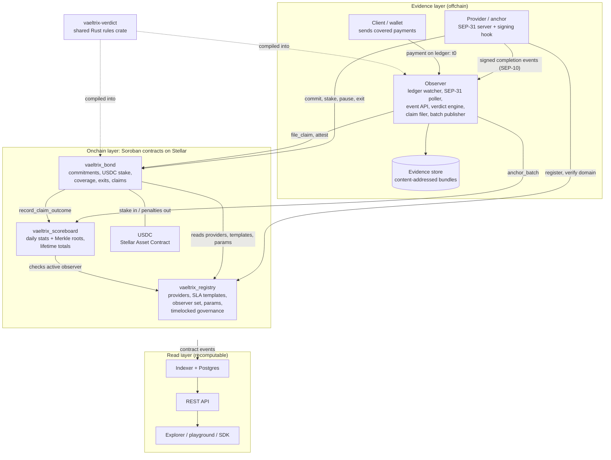
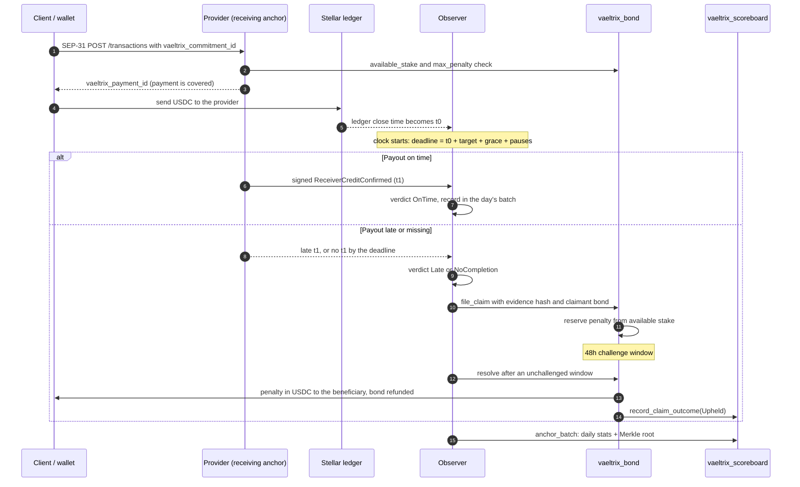
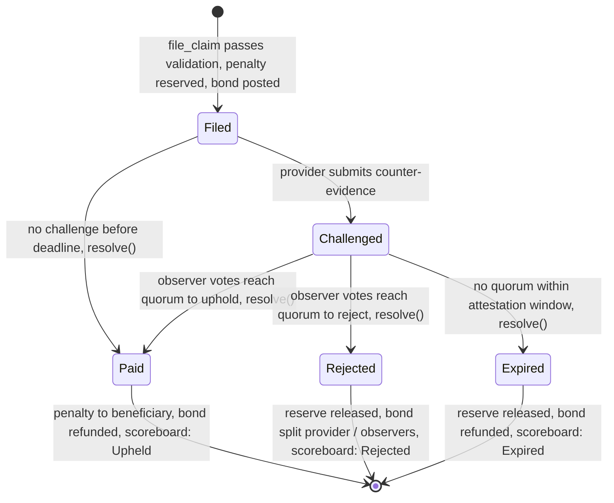

# Vaeltrix Technical Specification

Vaeltrix is an open Soroban protocol that lets Stellar payment providers stake USDC against public, machine-readable payout-time agreements, and pays the sender automatically when a covered SEP-31 payout breaches its agreement. Every outcome feeds a public reliability scoreboard per provider, corridor and asset.

This document describes the protocol as built in [`Vaeltrix-SCF/vaeltrix-contracts`](https://github.com/Vaeltrix-SCF/vaeltrix-contracts) and the parts still to come. Each section marks its status:

- **Built**: implemented, tested and deployed on Stellar testnet
- **Planned**: specified here, not implemented yet

## Contents

1. [Problem](#1-problem)
2. [Design principles](#2-design-principles)
3. [Participants](#3-participants)
4. [System architecture](#4-system-architecture)
5. [Data model](#5-data-model)
6. [Measurement model](#6-measurement-model)
7. [SLA templates and penalties](#7-sla-templates-and-penalties)
8. [Contract specifications](#8-contract-specifications)
9. [Protocol flows](#9-protocol-flows)
10. [Claims and dispute resolution](#10-claims-and-dispute-resolution)
11. [Observers](#11-observers)
12. [Scoreboard and metrics](#12-scoreboard-and-metrics)
13. [Economics](#13-economics)
14. [Security and threat model](#14-security-and-threat-model)
15. [Stellar integration](#15-stellar-integration)
16. [Off-chain services and SDK](#16-off-chain-services-and-sdk)
17. [Testnet deployment](#17-testnet-deployment)
18. [Roadmap](#18-roadmap)
19. [Open questions](#19-open-questions)

---

## 1. Problem

Stellar settles the onchain leg of a cross-border payment in seconds. The slow, failure-prone leg is the receiving anchor's payout to a bank account or mobile money wallet, which happens offchain and leaves no onchain trace.

- **Performance varies and is invisible.** Payout latency, banking partner uptime and failure handling differ widely between anchors, and none of it is published in a comparable form.
- **Service terms are private.** Where terms exist, they sit in bilateral agreements. A wallet integrating ten anchors negotiates ten contracts and still has no live signal.
- **There is no automatic remedy.** SEP-31 lets an anchor report a `status_eta`, but nothing holds it to that estimate. A stalled payment becomes a support ticket that rarely compensates anyone.

Offchain service agreements fail at remittance sizes because enforcing them costs more than the claim. A Soroban contract makes enforcement nearly free: the bond is already locked, the rules are public, and payout is a function call.

## 2. Design principles

1. **Measure what counterparties can observe.** Start and end times come from the ledger and from signatures by the party that saw each event, never from the provider's report alone.
2. **Enforce per payment, report statistically.** Penalties attach to individual, provable breaches. Percentiles are published, not enforced.
3. **Optimistic by default, adjudicated on dispute.** A claim pays out after an unchallenged window. Observers vote only when a provider contests.
4. **Stake is a bond, not a pool.** Each commitment's stake backs only that commitment. No lending, no yield strategies, no shared pool.
5. **Templates over bespoke terms.** A small set of governance-approved templates keeps providers comparable.
6. **Fair to providers.** Bank holidays, compliance holds and recipient-side errors are handled by explicit, published carve-outs.
7. **Minimal onchain footprint.** Commitments, claims and aggregates live onchain. Raw payment logs stay offchain, anchored by hashes and Merkle roots.

## 3. Participants

| Role | Who | Responsibilities | Exposure |
| --- | --- | --- | --- |
| Provider | Anchors, payment providers, fintechs | Register, commit to templates, lock stake, tag payments, sign completion events, respond to challenges | Stake pays penalties on upheld claims |
| Client | Wallets, sending anchors, remittance apps | Route payments, require coverage, file or delegate claims | Claim bond lost on rejected claims |
| Observer | Independent operators; one reference observer in V0 | Collect signed events, compute verdicts, file claims, attest, publish period batches | Provably false attestations are slashable from V1 |
| Beneficiary | The sending client by default | Receives penalties | None |
| Governance | Protocol maintainers, moving to a council | Approve templates, set parameters, manage observers and verifier, upgrade contracts behind a timelock | Cannot move stake or override a resolved claim |

An observer may not also be a provider admin. The registry enforces this when an observer is added and when a provider registers.

## 4. System architecture

Vaeltrix has three layers. The onchain layer holds identities, stake, claims and aggregates. The evidence layer, run by observers, turns payment reality into claims and batches. The read layer is fully recomputable from the two above it.



### 4.1 Why three contracts

- **Registry** changes rarely and is read by everything. Keeping it separate keeps its storage cheap and its upgrade path independent.
- **Bond** holds all value. Claims live in the same contract as stake, so a penalty payout is a single internal transfer with no cross-contract failure mode.
- **Scoreboard** takes frequent batch writes and holds no funds, so a bug in aggregation can never touch stake.

### 4.2 Trust boundaries

1. **Ledger data is trustless.** Settlement time and amount come straight from the Stellar ledger.
2. **Provider and client signatures are attributable.** They are self-reported, but a false signature is a permanent, signed record of fraud.
3. **Observer attestations are where offchain truth becomes onchain fact.** That trust starts with one transparent observer and moves to a bonded quorum (section 11).

### 4.3 Shared crates — Built

| Crate | Role |
| --- | --- |
| `vaeltrix-types` | Frozen `#[contracttype]` structs and enums, 44 append-only error codes, identifier recipes, cross-contract client traits |
| `vaeltrix-verdict` | Pure, allocation-free, overflow-safe SLA rules, compiled into the contracts and the observer and checked against test vectors that the TypeScript code must also pass |

Because contracts and observers compile the same rules, they cannot disagree on whether a payment was late.

## 5. Data model

Five objects carry the protocol. Templates are immutable once proposed; everything else has a lifecycle. All amounts are `i128` in the asset's smallest unit (1 USDC = `10_000_000`), and all times are `u64`.

### 5.1 Provider — Built

```rust
pub struct Provider {
    pub id: BytesN<32>,            // see 5.6
    pub admin: Address,            // controls stake and commitments
    pub signers: Vec<BytesN<32>>,  // ed25519 keys that sign completion events
    pub home_domain: String,       // serves stellar.toml listing this id
    pub metadata_uri: String,
    pub verified: bool,            // set by the verifier role after a stellar.toml check
    pub status: ProviderStatus,    // Active | Suspended | Exited
    pub registered_at: u64,
}
```

### 5.2 SLA template — Built

```rust
pub struct SlaTemplate {
    pub id: u32,
    pub version: u32,
    pub metric: Metric,               // TimeToCompletion
    pub start_event: EventKind,       // OnChainSettled
    pub end_event: EventKind,         // ReceiverCreditConfirmed
    pub target_ms: u64,
    pub grace_ms: u64,                // must not exceed target_ms
    pub penalty: PenaltyModel,        // PerBreachBps { bps, cap }
    pub scope: Scope,                 // asset, direction, countries, amount band, rail
    pub carve_outs: Vec<CarveOut>,
    pub max_hold_ms: u64,             // compliance hold cap, at most 48 hours
    pub claim_window_secs: u64,
    pub evidence_mode: EvidenceMode,  // DualSigned | ProviderSigned | ObserverOnly
    pub status: TemplateStatus,       // Proposed | Active | Deprecated
    pub activates_at: u64,
}
```

### 5.3 Commitment — Built

A provider's opt-in to one template version, backed by stake.

```rust
pub struct Commitment {
    pub id: u64,
    pub provider_id: BytesN<32>,
    pub template_id: u32,
    pub template_version: u32,       // pinned at commit time
    pub stake_asset: Address,
    pub stake_total: i128,
    pub stake_reserved: i128,        // held against open claims
    pub min_stake: i128,
    pub max_volume_per_period: i128, // 0 = no declared ceiling
    pub period_secs: u64,
    pub effective_from: u64,
    pub effective_to: Option<u64>,
    pub paused_at: Option<u64>,
    pub resumed_at: Option<u64>,
    pub exit_requested_at: Option<u64>,
    pub exit_cooldown_secs: u64,     // frozen at commit time
    pub open_claims: u32,
    pub status: CommitmentStatus,    // Active | Paused | Exiting | Exited
}
```

Available stake is `stake_total - stake_reserved`. A provider may only tag a new payment if available stake covers that payment's maximum penalty, so every covered payment is fully collateralised when it is tagged.

### 5.4 Payment reference — Built (type), Planned (use)

Payments live offchain. A payment appears onchain only inside a claim, or as a leaf under a batch's Merkle root.

```rust
pub struct PaymentRef {
    pub payment_id: BytesN<32>,
    pub sep31_tx_id: String,
    pub commitment_id: u64,
    pub amount: i128,
    pub t0_ms: u64,
    pub t1_ms: Option<u64>,
    pub pause_ms: u64,               // total carve-out pause
    pub evidence_hash: BytesN<32>,   // hash of the full evidence bundle
}
```

### 5.5 Claim — Built (type), Planned (functions)

```rust
pub struct Claim {
    pub id: u64,
    pub commitment_id: u64,
    pub provider_id: BytesN<32>,
    pub payment: PaymentRef,
    pub breach: BreachKind,               // LateCompletion | NoCompletion
    pub claimant: Address,
    pub beneficiary: Address,
    pub bond_payer: Address,
    pub filed_by_observer: Option<Address>,
    pub penalty_amount: i128,
    pub reserved_amount: i128,
    pub shortfall: i128,                  // penalty not covered by stake, if any
    pub claim_bond: i128,
    pub status: ClaimStatus,              // Filed | Challenged | Paid | Rejected | Expired
    pub filed_at: u64,
    pub challenge_deadline: u64,
    pub attestation_deadline: u64,
    pub counter_evidence_hash: Option<BytesN<32>>,
    pub votes_for: u32,
    pub votes_against: u32,
}
```

### 5.6 Identifiers — Built

| Identifier | Derivation | Why |
| --- | --- | --- |
| `provider_id` | `sha256("VAELTRIX:PROVIDER:v1" ‖ lowercase(home_domain) ‖ ScAddress(admin))` | Binds identity to a verifiable domain |
| `payment_id` | `sha256("VAELTRIX:PAYMENT:v1" ‖ sep31_tx_id ‖ provider_id)` | Unique per provider, cannot collide across anchors |
| `commitment_id`, `claim_id` | Monotonic counters in contract storage | Cheap and ordered |
| `evidence_hash` | sha256 of the canonical evidence bundle | Anyone can check offchain evidence matches the claim |

## 6. Measurement model

The protocol is only as credible as its timestamps, so the start of a payment comes from the ledger and its completion is signed by the party that performed it.

### 6.1 Canonical events

| Event | Signed by | Meaning | SEP-31 source |
| --- | --- | --- | --- |
| `OnChainSettled` (t0) | Stellar ledger | Payment to the receiving anchor included in a ledger | `stellar_transaction_id` |
| `ReceiverAccepted` | Receiving anchor | Status moves to `pending_receiver` | `GET /transactions/:id` |
| `ReceiverCreditConfirmed` (t1) | Receiving anchor, co-signed by the payout rail where available | Beneficiary credited | Status `completed`, `completed_at` |
| `SenderDebitConfirmed` | Sending client | Sender's funds debited | Client ledger |
| `RecipientAcknowledged` | End user via wallet | Recipient confirms receipt (later versions) | Wallet callback |

The registry only accepts templates that start at `OnChainSettled` and end at `ReceiverCreditConfirmed`. Using ledger close as t0 means the agreement measures exactly the part of the flow the receiving anchor controls.

### 6.2 Breach condition — Built (`vaeltrix-verdict`)

```
deadline = t0 + target_ms + grace_ms + pause_ms
latency  = t1 - t0 - pause_ms

OnTime        if t1 exists and latency <= target_ms + grace_ms
Late          if t1 exists and latency >  target_ms + grace_ms
NoCompletion  if t1 is missing and now > deadline
Pending       otherwise
```

A provider that never signs a completion is in breach at the deadline. Silence is never safer than honesty.

### 6.3 Evidence modes

| Mode | t0 | t1 | Trust assumption | Use |
| --- | --- | --- | --- | --- |
| DualSigned | Ledger close or client signature | Provider signature plus observer attestation | Provider cannot fake t1 without a colluding observer | Default |
| ProviderSigned | Ledger close | Provider signature | Misreporting is fraud with a signed record | Early pilots |
| ObserverOnly | Observer | Observer polling SEP-31 status | Polling interval bounds accuracy | Fallback, and the testnet demo template |

### 6.4 Carve-outs — Built (`vaeltrix-verdict`)

Carve-outs pause the clock. Each must be declared in real time with a signed reason code, and each is published on the scoreboard so overuse is visible.

| Carve-out | Effect | Abuse control |
| --- | --- | --- |
| `ReceiverBankHoliday` | Clock pauses for the holiday | Calendar fixed per corridor by governance |
| `ComplianceHoldDeclared` | Clock pauses until release, capped at the template's `max_hold_ms` (at most 48 hours) | Hold rate per provider is published |
| `InvalidBeneficiary` | Payment leaves agreement scope | Refund must be onchain and observable |
| `SenderInfoIncomplete` | Clock pauses until information is supplied | Timestamped by the client's response |

`apply_carve_outs` merges overlapping pause intervals without allocating, caps compliance holds before merging, and marks a payment out of scope on an invalid beneficiary.

### 6.5 Clocks

- Ledger close time is accurate to about one ledger (roughly 5 seconds).
- Signed offchain events carry an RFC 3339 timestamp. Observers reject events more than 30 seconds ahead of their own NTP-synced clock.
- `grace_ms` absorbs the remaining skew.

### 6.6 Signed event format — Planned

```json
{
  "v": 1,
  "event": "receiver_credit_confirmed",
  "payment_id": "b3f1...9a",
  "sep31_tx_id": "82fhs729f63dh0v4",
  "provider_id": "7c2e...41",
  "commitment_id": 42,
  "ts": "2026-10-11T14:03:22.418Z",
  "rail_ref": "NIP-000013261011140322",
  "sig": "ed25519:..."
}
```

`rail_ref` carries the payout rail's own reference, such as a NIBSS NIP session ID, so a dispute can be checked against a third-party record.

## 7. SLA templates and penalties

### 7.1 Templates

Templates are proposed by governance, become active only after the timelock, and are versioned and immutable. A change creates a new version; existing commitments stay pinned to the version they signed.

Launch templates proposed for pilots:

| ID | Name | Scope | Target | Grace | Penalty | Claim window |
| --- | --- | --- | --- | --- | --- | --- |
| 1 | Fast inbound bank payout | SEP-31 inbound, USDC, bank rail, 10 to 10,000 USDC | 60 min | 2 min | 50 bps, cap 50 USDC | 7 days |
| 2 | Same-day inbound bank payout | SEP-31 inbound, USDC, bank rail | 8 h | 5 min | 25 bps, cap 250 USDC | 14 days |
| 3 | Instant mobile money payout | SEP-31 inbound, USDC, mobile money, 1 to 2,000 USDC | 15 min | 1 min | 100 bps, cap 20 USDC | 7 days |

Deployed on testnet today is **template 901**, a fast demo template: 2-minute target, 10 seconds of grace, 5% penalty capped at 100 USDC, a 10-minute claim window, a 60-second compliance hold cap and `ObserverOnly` evidence.

### 7.2 Penalty model — Built

V0 uses one model, `PerBreachBps { bps, cap }`:

```
penalty = min(floor(amount × bps / 10_000), cap)
```

Division rounds down in the provider's favour, and the cap is applied after flooring. The enum is designed so `Flat`, `Graduated` and `Statistical` models can be added later without migrating existing commitments.

### 7.3 Sizing check

```
expected monthly penalty = volume × breach rate × bps / 10_000
```

At 1M USDC monthly volume, a 2% breach rate and 50 bps, expected penalties are 100 USDC a month, about 1 to 2% of a provider's fee revenue at 50 to 100 bps. That is meaningful as a signal and survivable as a cost.

## 8. Contract specifications

All three contracts are written for Soroban SDK 29 on Stellar Protocol 29. Contract code has no `unwrap`, `expect` or `panic!`: workspace lints deny them outside tests, and every arithmetic step uses `checked_*` with an explicit `ArithmeticOverflow` error.

### 8.1 `vaeltrix_registry` — Built, 26 tests

| Function | Who | Behaviour |
| --- | --- | --- |
| `__constructor(admin, params)` | Deployer | Validates parameters; the admin is the initial verifier |
| `register_provider(admin, home_domain, signers, metadata_uri)` | Provider admin | Lowercase DNS domain only, bounded signers with no duplicates, rejects active observers, rejects duplicates |
| `update_signers`, `update_metadata` | Provider admin | Identity and admin are preserved |
| `verify_domain`, `unverify_domain` | Verifier role | Set after the verifier checks the provider's `stellar.toml` |
| `suspend_provider`, `reinstate_provider` | Admin | Suspension blocks new commitments and stake top-ups |
| `propose_template`, `activate_template`, `cancel_template`, `deprecate_template` | Admin; activation by anyone after `activates_at` | Version must increment by one; every field is validated |
| `get_template`, `get_template_version`, `template_ids` | Anyone | `get_template` returns the active version only |
| `propose(kind)`, `execute(id)`, `cancel(id)`, `action(id)` | Admin; execution by anyone after the timelock | Governance queue for `SetParams`, `AddObserver`, `RemoveObserver`, `SetVerifier`, `Upgrade` |
| `propose_admin`, `accept_admin` | Admin, then the new admin | Two-step handover |
| `is_active_observer`, `active_observer_count`, `observers`, `params`, `admin` | Anyone | Views |

Observer independence is checked twice: when the action is proposed and again when it executes, because a provider could register during the timelock. Removed observers keep their record so historical attribution survives.

### 8.2 `vaeltrix_bond` — Built (commitments, stake, coverage, exits), Planned (claims), 16 tests

| Function | Who | Behaviour |
| --- | --- | --- |
| `__constructor(admin, registry, scoreboard)` | Deployer | Initialises counters |
| `commit(provider_id, template_id, stake_asset, amount, max_volume_per_period, period_secs)` | Provider admin | Provider must be active and verified; asset must match the template and be allowed; stake must meet `min_stake`, cover the template's maximum penalty and stay under the stake cap; freezes the exit cooldown; transfers USDC in |
| `add_stake`, `withdraw_excess` | Provider admin | Withdrawals can never take `stake_total - stake_reserved` below `min_stake` |
| `pause`, `resume` | Provider admin | Records pause and resume times; claims continue while paused |
| `is_covered(commitment_id, t0_ms)` | Anyone | True if the commitment covered a payment at that moment, given pause, resume, exit and effective dates |
| `available_stake`, `max_penalty`, `commitment`, `commitments_by_provider` | Anyone | Views |
| `request_exit`, `finalize_exit` | Provider admin | Exit only after the frozen cooldown and with no open claims; returns all stake |
| `propose_upgrade`, `execute_upgrade`, `cancel_upgrade` | Admin; execution by anyone after the timelock | Uses the registry's timelock |
| `file_claim`, `challenge`, `attest`, `resolve`, `claim` | Claimant, provider, observers, anyone | **Planned.** See section 10 |

Invariants:

1. `stake_reserved <= stake_total` at all times.
2. A claim reserves its penalty on filing. Resolution either pays it out (upheld) or releases it (rejected or expired).
3. `finalize_exit` fails while any claim is open or before `exit_requested_at + exit_cooldown_secs`.
4. `exit_cooldown_secs >= claim window + challenge window + attestation window + extra`, computed per template at commit time.
5. One claim per `payment_id`.
6. Stake leaves the contract only to a beneficiary (upheld claim), to the provider (exit or excess withdrawal) or to the claimant (bond refund).

### 8.3 `vaeltrix_scoreboard` — Built, 10 tests

| Function | Who | Behaviour |
| --- | --- | --- |
| `__constructor(admin, registry)` | Deployer | |
| `set_bond(bond)` | Admin, once | Fixes the only address allowed to record claim outcomes |
| `anchor_batch(observer, commitment_id, provider_id, period_start, period_end, merkle_root, stats, attestation_hash)` | Active observer | One UTC day per batch, not in the future, no duplicates; `on_time + breaches + carved_out` must equal `payments`, percentiles must be ordered, an empty day must have a zero root |
| `record_claim_outcome(claim, outcome)` | Bond contract only | Updates lifetime penalties, shortfall and upheld, rejected and expired counts |
| `batch`, `stats`, `periods`, `lifetime` | Anyone | Keeps the last 90 periods per commitment |

```rust
pub struct PeriodStats {
    pub payments: u32, pub on_time: u32, pub breaches: u32, pub carved_out: u32,
    pub p50_ms: u64, pub p95_ms: u64, pub p99_ms: u64,
    pub volume: i128, pub penalties_paid: i128,
}
```

### 8.4 Events — Built (except claim events)

Every state change emits a Soroban event, so indexers never read storage directly.

| Contract | Topics |
| --- | --- |
| Registry | `init`, `adm_prop`, `adm_set`, `act_prop`, `act_exec`, `act_canc`, `prov_reg`, `prov_sig`, `prov_meta`, `prov_ver`, `prov_unv`, `prov_sus`, `prov_rein`, `tmpl_prop`, `tmpl_act`, `tmpl_canc`, `tmpl_dep`, `obs_add`, `obs_rm` |
| Bond | `commit`, `stake_chg`, `cmt_pause`, `cmt_resum`, `exit_req`, `exit_fin`, `upg_prop`, `upg_exec`; planned: `claim_new`, `claim_chal`, `claim_att`, `claim_res` |
| Scoreboard | `bond_set`, `batch`, `claim_out` |

### 8.5 Storage and TTL — Built

| Data | Storage | TTL policy |
| --- | --- | --- |
| Admin, parameters, counters | Instance | Extended by 30 days whenever under 7 days |
| Providers, templates, commitments, batches, lifetime stats | Persistent | Extended by 120 days whenever under 30 days, on every touch |
| Open claims | Persistent | Must not expire mid-dispute |
| Resolved claims | Persistent | Extended by 90 days; history also lives in events and the indexer |

### 8.6 Upgrades — Built

Registry upgrades go through the governance queue; the bond contract has its own `propose_upgrade` and `execute_upgrade`, which read the registry's timelock. On mainnet the timelock must exceed the longest exit cooldown, so a provider who disagrees with an upgrade can leave with full stake before it applies.

## 9. Protocol flows

### 9.1 Provider onboarding

1. The provider publishes a `[VAELTRIX]` block in its `stellar.toml`.
2. The provider calls `register_provider` with its admin, home domain and signer keys.
3. The verifier fetches `stellar.toml`, confirms the IDs and calls `verify_domain`.
4. The provider calls `commit` for a template, transferring USDC stake into the bond contract.
5. The provider lists the commitment in its SEP-31 `GET /info` response.
6. The observer starts watching payments into the provider's receiving accounts.

### 9.2 Payment under SLA and breach claim



On the happy path nothing touches stake: the payment is simply counted as on time in the next daily batch.

### 9.3 Exit

1. The provider calls `request_exit`. The commitment becomes `Exiting` and stops covering new payments.
2. The cooldown runs. It is longer than the claim, challenge and attestation windows combined.
3. The provider calls `finalize_exit`. It fails if any claim is open; otherwise all remaining stake returns to the provider admin.

## 10. Claims and dispute resolution — Planned

Claims are optimistic: a filed claim pays out after its challenge window unless the provider contests it, and only contested claims reach the observers.



A claim that fails validation at filing reverts and never enters this machine.

### 10.1 Validation at filing

`file_claim` reverts unless:

1. The commitment covered the payment at t0 (`is_covered`).
2. Amount, asset and corridor fall inside the template scope.
3. `now <= t0 + target_ms + grace_ms + pause_ms + claim_window_secs`.
4. No claim already exists for this `payment_id`.
5. The evidence hashes to `payment.evidence_hash` and includes the ledger transaction for t0.
6. The breach condition (section 6.2) holds on the submitted timestamps.
7. The claimant transfers the claim bond.
8. The penalty is moved from available stake to `stake_reserved`. If stake cannot cover it in full, the uncovered part is recorded as `shortfall`.

### 10.2 Windows

| Window | Mainnet proposal | Testnet value | Starts at |
| --- | --- | --- | --- |
| Claim window | 7 or 14 days, per template | 10 minutes (template 901) | Breach deadline |
| Challenge window | 48 hours | 180 seconds | Filing |
| Attestation window | 72 hours | 300 seconds | Challenge |
| Exit cooldown | Sum of the above plus 7 days | Sum of the above plus 120 seconds | Exit request |

### 10.3 Resolution

- **Challenge:** the provider submits counter-evidence, usually a signed t1 the claimant omitted or proof a carve-out applied. Challenging is free, because the provider's stake is already at risk; frivolous challenges show up as a challenge-rejection rate.
- **Attestation:** each observer runs the published verdict function over the combined evidence and calls `attest` with uphold true or false.
- **Upheld:** the reserved penalty goes to the beneficiary and the bond is refunded.
- **Rejected:** the reserve returns to available stake, and the bond is split: `rejected_bond_provider_bps` (50%) to the provider and the rest equally among attesting observers, with rounding dust to the provider.
- **Expired:** no quorum within the attestation window. The reserve is released and the bond refunded in full; repeated expiries trigger an observer liveness review.

### 10.4 What the protocol does not judge

Vaeltrix does not decide whether a delay was fair, whether a bank was at fault, or whether the recipient suffered loss. It decides only whether the signed timeline breaches the template as written. That narrowness is what makes it automatable.

## 11. Observers

### 11.1 What an observer does — Planned (service)

1. Indexes payments into registered providers' receiving accounts from Stellar RPC. Each match produces an `OnChainSettled` event (t0).
2. Receives signed events pushed by providers and clients through the event API, and polls each provider's SEP-31 `GET /transactions/:id` as a fallback.
3. Verifies signatures against the provider's registered signer keys and checks timestamps against its own clock.
4. Builds and stores each payment's evidence bundle, content-addressed by `evidence_hash`.
5. Files claims automatically when a breach is detected and the client has delegated filing.
6. Attests on challenged claims.
7. Publishes a daily batch per commitment: a Merkle root over every payment record plus aggregate statistics.

### 11.2 Phased trust model

| Phase | Observer set | Quorum | Observer bond | Stake cap |
| --- | --- | --- | --- | --- |
| V0, testnet | 1 reference observer | 1 of 1 | None | Testnet only |
| V1, mainnet pilot | 5 permissioned, at least 3 independent of the team | 3 of 5 | Fixed per observer | Capped by governance |
| V2 | 7 to 11 onboarded by governance | Two thirds | Scales with stake secured | Raised as the set grows |
| V3 | Permissionless with staking | Stake-weighted two thirds | Market set | Uncapped |

The registry already bounds the set at 32 observers, enforces independence from providers, and changes membership only through the timelock.

### 11.3 Attestation format — Planned

```json
{
  "v": 1,
  "claim_id": 1187,
  "payment_id": "b3f1...9a",
  "evidence_hash": "e91c...07",
  "computed_latency_ms": 5512000,
  "carve_outs_applied": [],
  "verdict": "uphold",
  "observer": "GOBS...",
  "observed_at": "2026-10-11T16:12:00Z",
  "sig": "ed25519:..."
}
```

The onchain `attest` call carries only the claim ID, the verdict and a signature over this document's canonical hash. The full document goes to the observer's public log.

### 11.4 Accountability

- **Determinism:** every honest observer computes the same verdict from the same evidence, because the verdict function is open source with a published vector suite.
- **Provable misbehaviour:** an attestation that contradicts the evidence it signed over is slashable from V1.
- **Liveness:** an observer that misses more than 10% of attestation requests in 30 days can be rotated out.
- **Independence:** no organisation runs more than one observer in V1, and providers never vote on their own claims.

## 12. Scoreboard and metrics

### 12.1 Published metrics

| Metric | Source | Notes |
| --- | --- | --- |
| Covered payments and volume | Daily batches | Per provider, template, corridor and amount band |
| On-time rate | Daily batches | Carved-out payments shown separately |
| Latency p50, p95, p99 | Daily batches | Computed offchain, committed by Merkle root |
| Breach count | Batches and claims | Includes breaches nobody claimed |
| Carve-out rate by reason | Daily batches | Exposes overuse of compliance holds |
| Penalties paid, shortfall | Bond and scoreboard | Fully onchain |
| Claim outcomes | Scoreboard lifetime totals | Upheld, rejected, expired |
| Stake at risk, coverage ratio | Bond storage | Live |

### 12.2 Verifiable aggregates

Percentiles are too expensive to compute onchain. Each day the observer publishes a Merkle root over every payment record (`payment_id`, amount, t0, t1, carve-out, breach), sorted by `payment_id`, together with the signed `PeriodStats`. Anyone can download the records, recompute the statistics, check the root and report a mismatch. In V1 a day is final only when a quorum of observers posts matching roots.

### 12.3 Reliability score

The explorer derives one headline number per commitment, published as a separate versioned formula so it can change without touching contracts:

```
score = 100 × on_time_rate_30d
            × (1 − min(carve_out_rate / 0.2, 0.5))
            × min(coverage_ratio / 1.5, 1)
```

It rewards punctuality, discounts heavy carve-out use and penalises thin collateral. A provider with fewer than 100 covered payments in 30 days is shown as "insufficient data".

### 12.4 Privacy

Records carry no personal data: no names, account numbers or bank details. Amounts are shown in bands in the explorer, and providers can opt into banded volume publication at the cost of lower displayed confidence.

## 13. Economics

### 13.1 Why a provider stakes

| Incentive | Mechanism |
| --- | --- |
| Routing preference | Wallets route to bonded providers first, the primary driver |
| Enterprise sales | A public bonded agreement shortens procurement with fintechs and banks |
| Pricing power | Proven reliability supports higher fees on premium corridors |
| Lower support cost | Automatic penalties replace manual disputes |
| Competitive signal | A visible score pressures providers who have not opted in |

### 13.2 Stake sizing — Built

```
min_stake = max(stake_floor, k × daily_volume_cap × bps / 10_000)
```

With `k = 3`, a commitment can absorb three full days in which every payment breaches. The commit also requires stake of at least the template's maximum single penalty. Testnet parameters: a floor of 100 USDC, `k = 3` and a cap of 10,000 USDC per commitment.

### 13.3 Claim bond

The bond is the greater of `min_claim_bond` (1 USDC) and `claim_bond_bps` (10%) of the claimed penalty. It is refunded on upheld and expired claims and split between provider and observers on rejected ones.

### 13.4 Protocol fee and sustainability

V0 charges no fees. A later version may take a small share of each upheld penalty to fund observers and the explorer, kept small enough that it never changes whether filing a claim is worthwhile. All code is Apache-2.0.

### 13.5 Stake asset

V0 accepts USDC only, which avoids price risk on the bond and matches the payment asset. Other stake assets would need price feeds and haircuts and are deferred.

## 14. Security and threat model

The highest risks are falsified timestamps and observer collusion; contract bugs come next.

| # | Threat | Mitigation | Version |
| --- | --- | --- | --- |
| T1 | Provider backdates its completion signature | Signed t1 is an attributable record; `rail_ref` for a third-party check; observer cross-checks SEP-31 status | V0, stronger in V2 |
| T2 | Provider withholds completion past the claim window | A missing t1 at the deadline is itself a breach | V0 |
| T3 | Client files false claims | Claim bond; evidence must include ledger t0; provider can challenge with a signed t1 | V0 |
| T4 | Spam claims | Bond scales with penalty; one claim per payment; per-claimant rate limits in the observer | V0 |
| T5 | Provider exits with open claims | Exit blocked while claims are open; cooldown exceeds every window | V0, built |
| T6, T7 | Observer colludes with provider or claimant | Independent quorum; clients can file directly; false attestations slashable; stake caps while the set is small | V1 |
| T8 | Wash volume to pad a score | Per-amount-band statistics; flag payments where sender and receiver are the same entity | V1 |
| T9 | Carve-out abuse | Carve-out rate published; template cap on holds | V0 |
| T10 | Signing key compromise | Multiple registered signers, rotation, suspicious-pattern alerts | V0, rotation built |
| T11 | Contract bug drains stake | Invariant and property tests, stake caps during pilots, timelocked upgrades, audit before mainnet | Pre-mainnet |
| T12 | Governance capture | Governance cannot move stake; timelock longer than the exit cooldown | V0, built |
| T13 | State archival removes an open claim | Persistent storage with TTL extension on every touch | V0, built |

**Residual risk in V0:** with a single reference observer, collusion is limited only by transparency and the testnet-only scope. Until payout rails sign directly, a provider willing to commit signed fraud can misreport, but the fraud is permanent and attributable.

A formal STRIDE threat model and an onchain monitoring plan are planned deliverables.

## 15. Stellar integration

Vaeltrix needs no change to SEP-31. It uses existing discovery, authentication and transaction fields, plus one optional extension that can later become its own SEP.

### 15.1 SEP-1 (`stellar.toml`)

```toml
[VAELTRIX]
PROVIDER_ID = "7c2e...41"
REGISTRY_CONTRACT = "CBBZQ577QYKADNBAYBYN56Q3ZDTDQYCBOGREHBFEVOWOI5F27TJBE6MO"
COMMITMENTS = [42, 57]
EVENT_SIGNING_KEYS = ["GSIGN1...", "GSIGN2..."]
```

The verifier checks this block against the registry before calling `verify_domain`.

### 15.2 SEP-31

| SEP-31 element | Vaeltrix use |
| --- | --- |
| `GET /info` | A `vaeltrix` object per asset listing active commitment and template IDs |
| `POST /transactions` request | The sending side may include `vaeltrix_commitment_id` to require coverage |
| `POST /transactions` response | The receiver returns `vaeltrix_payment_id` to confirm coverage |
| `stellar_transaction_id` | Links the settlement to the payment and gives t0 |
| Status transitions | Polled as a cross-check; `pending_customer_info_update` and `error` map to carve-outs |
| `completed_at` | Must equal the signed t1 within grace; a mismatch is flagged |

```json
{
  "receive": {
    "USDC": {
      "enabled": true,
      "vaeltrix": {
        "commitments": [
          { "commitment_id": 42, "template_id": 1, "corridors": ["US-NG"] }
        ]
      }
    }
  }
}
```

### 15.3 SEP-10 and SEP-45

The event API authenticates classic accounts with SEP-10 and contract accounts with SEP-45. The authenticated account must match a registered provider admin or client key.

### 15.4 Stellar Asset Contract

All stake, bonds and penalties move through the USDC Stellar Asset Contract, so balances and transfers are visible to any Stellar wallet or explorer.

### 15.5 Later flows

SEP-24 and SEP-6 deposits and withdrawals have similar offchain legs and can reuse the same event model with different start events. These are V2 scope.

## 16. Off-chain services and SDK

| Component | Language | Responsibility | Status |
| --- | --- | --- | --- |
| Playground | React, Vite | Reads deployed state with no wallet; with Freighter: register a provider, commit, add or withdraw stake, pause and resume | Built, live |
| Postgres schema | SQL | 14 tables: cursors, chain events, providers, templates, commitments, payments, signed events, evidence bundles, claims, claim votes, attestations, batches, delegations, observer jobs | Built |
| `services/api` | TypeScript, Fastify | Read-only API with a SELECT-only database role and OpenAPI output; business endpoints next | Foundation built |
| `services/observer` | TypeScript | Ledger watcher, SEP-31 poller, event API, verdicts, claim filer, attestations, batch publisher | Planned |
| `services/indexer` | TypeScript, Postgres | Indexes contract events for the API and explorer | Planned |
| `services/mock-anchor` | TypeScript | Reference SEP-31 server for demos and tests | Planned |
| `@vaeltrix/sdk` | TypeScript | Contract bindings, payment tagging, completion signing, claims, scoreboard queries | Planned |
| Deploy and seed scripts | TypeScript | Deploy registry, scoreboard and bond, wire them, seed template 901 and a demo commitment | Built |

### 16.1 SDK surface — Planned

```ts
import { Vaeltrix } from "@vaeltrix/sdk";

const vaeltrix = new Vaeltrix({ network: "testnet", rpcUrl, signer });

// Provider onboarding
const providerId = await vaeltrix.providers.register({ homeDomain, signers, metadataUri });
const commitmentId = await vaeltrix.commitments.create({
  providerId, templateId: 1, stakeAsset: USDC, amount: 1_500_0000000n,
});

// Inside the anchor's SEP-31 handler
const tag = await vaeltrix.payments.tag({ commitmentId, sep31TxId, amount });
await vaeltrix.events.signCompletion({ paymentId: tag.paymentId, railRef, ts: new Date() });

// Client side
const score = await vaeltrix.scoreboard.get({ providerId, corridor: "US-NG", templateId: 1 });
const claimId = await vaeltrix.claims.file({ paymentId, beneficiary });
```

### 16.2 REST API — Planned

| Route | Returns |
| --- | --- |
| `GET /v1/providers` | Providers with verification status and headline score |
| `GET /v1/providers/:id` | Profile, commitments, lifetime stats |
| `GET /v1/commitments/:id/stats?period=30d` | Daily statistics series |
| `GET /v1/corridors/:corridor/rankings?template=1` | Providers ranked by score |
| `GET /v1/claims/:id` | Claim status, attestations, evidence hash |
| `GET /v1/evidence/:hash` | Full evidence bundle |
| `GET /v1/batches/:commitment/:period` | Merkle root, stats, record download link |
| `POST /v1/events` | Submit a signed event (SEP-10 or SEP-45 authenticated) |
| `POST /v1/claims/delegate` | Authorise the observer to file claims for a client |

### 16.3 Operations

- Observer uptime target 99.9%; missed events are recovered by SEP-31 polling and ledger replay.
- Evidence bundles are kept for at least the longest claim window plus one year.
- Observer logs are append-only and publicly mirrored.

## 17. Testnet deployment

Deployed on 21 October 2026, Stellar Protocol 29, built with `soroban-sdk` 29.0.1 and `stellar-cli` 28.1.0.

| Contract | ID |
| --- | --- |
| `vaeltrix_registry` | `CBBZQ577QYKADNBAYBYN56Q3ZDTDQYCBOGREHBFEVOWOI5F27TJBE6MO` |
| `vaeltrix_bond` | `CCYLDMTA4CTFF2VHULUCCBNCBMN3G7MA33EZ2OFYMIRSIKX3PYUHCUAI` |
| `vaeltrix_scoreboard` | `CD4TA5VDQUHF2LV5H5LWQSXRUSWTQYZN23MONYYUZQAJ5JBOEGYAP5EC` |
| Test USDC | `CB2CFWENJ2M5JXWBGUOKO75QVIFJ2EY5WOIOHR6FFYTXAKGS2S3XOIM4` |

Onchain state: template 901 active, one observer added through the timelock, commitment 1 holding 1,000 test USDC, coverage paused and resumed, and one scoreboard batch anchored. Explorer links for every contract and transaction are in [`test-net-deployment.md`](test-net-deployment.md); Wasm hashes are in [`deployments/testnet.json`](deployments/testnet.json).

Read the live stake without project keys:

```sh
stellar keys generate vx-reviewer --network testnet --fund
stellar contract invoke --network testnet --source vx-reviewer --send no \
  --id CCYLDMTA4CTFF2VHULUCCBNCBMN3G7MA33EZ2OFYMIRSIKX3PYUHCUAI \
  -- available_stake --id 1
# 10000000000 = 1,000 test USDC
```

## 18. Roadmap

Each phase is unlocked by a gate, not a date.

| Phase | Scope | Gate to the next phase |
| --- | --- | --- |
| V0 (testnet) | Three contracts, claims, reference observer, indexer, API, SDK, explorer, scripted breach demo | Two anchors integrated; every claim path (upheld, rejected, expired, exit) exercised; verdict vectors stable |
| V1 (mainnet pilot) | Five permissioned observers, capped stake, uptime and quote-honouring metrics | Independent audit with all critical findings fixed; one wallet commits to routing preference; five observers onboarded |
| V2 | Larger observer set, graduated and statistical penalties, SEP-24 and SEP-6, penalty pass-through | Observer quorum stable; three independent anchors staked on mainnet; no unresolved observer faults |
| V3 | Permissionless observers with staking | |

Build order inside V0:

1. Shared types and verdict crate — **done**
2. `vaeltrix_registry` — **done**
3. `vaeltrix_bond`: commitments and stake **done**; claims next
4. Observer ledger indexer and evidence builder
5. Claim and challenge flows end to end
6. `vaeltrix_scoreboard` **done**; batch publishing next
7. SDK, API and explorer
8. Pilot integration with two anchors

## 19. Open questions

- Which two anchors will pilot V0, and on which corridors?
- Will at least one wallet commit to routing preference for bonded providers?
- Is a 60-minute bank payout target realistic for Nigeria, Kenya and the Philippines, or should launch templates start at 4 hours?
- Can payout rails such as NIBSS NIP or M-Pesa provide a signed or queryable completion reference?
- How are penalties characterised legally in each launch jurisdiction: liquidated damages, rebate or performance bond payout?
- Should observers file claims for every breach, or only on client request?
- Who runs the first independent observers in V1?

### Key risks

| Risk | Likelihood | Impact | Response |
| --- | --- | --- | --- |
| Anchors refuse to stake | High | Fatal | Lead with the free observe-only scoreboard, then sell bonded agreements to providers who already score well |
| Wallets ignore scores | Medium | High | Secure routing commitments before mainnet; ship a wallet widget |
| Measurement disputes erode trust | Medium | High | Conservative carve-outs, generous grace, transparent evidence |
| Penalties too small to matter | Medium | Medium | Tune with pilot data; graduated penalties in V1 |
| Reclassification as insurance | Low to medium | High | Performance bond framing, counsel review per jurisdiction, no shared pool |
| Observer centralisation | High in V0 | Medium | Stake caps, fast move to a V1 quorum |

**Adoption wedge:** the scoreboard can run in observe-only mode for providers that have not staked, using ledger t0 and SEP-31 polling for t1. Publishing that data creates the pressure that makes staking attractive: good providers stake to prove it, and weak ones are visible either way.
