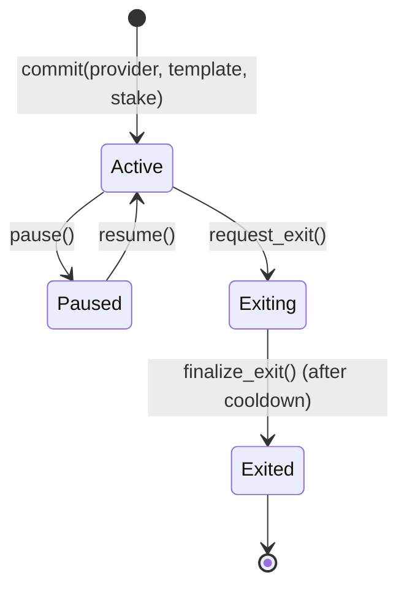
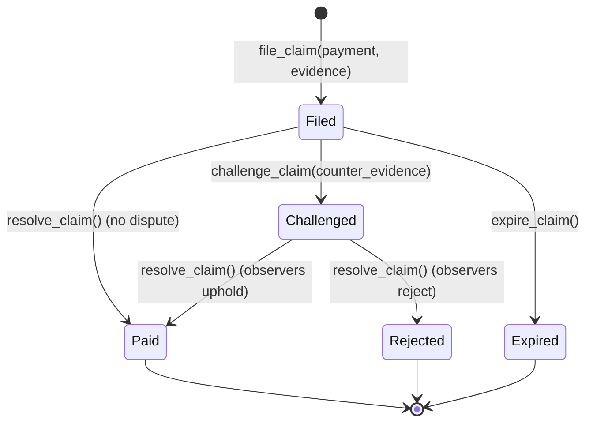

## Overview

Vaeltrix creates a financial bridge between fast onchain Stellar settlements and offchain banking / mobile money rails. Rather than relying on private agreements or unenforced estimates, Vaeltrix establishes a verifiable, staked SLA layer.



## Providers and identity

A **Provider** represents an anchor, payment processor, or fintech on Stellar.

- **Home domain binding:** Providers register with an admin address and a `home_domain` (e.g. `anchor.example.com`). This domain must host a standard SEP-1 `stellar.toml` file.
- **Provider ID derivation:** The unique 32-byte provider ID is derived deterministically from the home domain and admin address: `SHA256(home_domain + ":" + admin)`.
- **Signer keys:** Providers register Ed25519 public keys used to sign offchain completion receipts. Signers can be rotated by the provider admin without altering existing commitments.
- **Verification:** An independent verifier role checks that the provider admin key matches the signing keys published in the domain's `stellar.toml`. Until verified, providers cannot create active commitments.
- **Lifecycle states:**
  - `Active`: Normal operation; can create commitments and stake.
  - `Suspended`: Temporarily halted by governance due to fraud or domain compromise.
  - `Exited`: Voluntarily closed all commitments and exited the system.

## SLA templates and scope

An **SLA template** is an immutable, governance-approved performance standard:

- **Target and Grace durations:**
  - `target_ms`: Payout deadline (e.g. 3,600,000 ms = 60 minutes).
  - `grace_ms`: Buffer before breach penalties trigger (e.g. 900,000 ms = 15 minutes).
- **Metric:** `TimeToCompletion` measures the elapsed duration from payment initiation to final recipient delivery.
- **Scope filters:** A template defines strict coverage boundaries:
  - `asset`: The asset being staked and paid out (e.g. testnet USDC).
  - `direction`: `Inbound` (fiat deposit to Stellar token) or `Outbound` (Stellar token to local fiat payout).
  - `sender_country` / `receiver_country`: ISO country codes defining the remittance corridor.
  - `min_amount` and `max_amount`: Bounds in base units (e.g. $10 to $5,000).
- **Penalty model:** `PerBreachBps(bps, cap)` defines the compensation owed on breach:
  - `bps`: Basis points of the payment volume (e.g. 500 bps = 5%).
  - `cap`: Maximum penalty per payment in base units.

### Carve-outs and pauses

Real-world payouts encounter legitimate offchain interruptions. Vaeltrix accounts for these with published **carve-outs**:

| Carve-out | Description |
| --- | --- |
| `ReceiverBankHoliday` | Receiving commercial banks closed due to official holiday or weekend. |
| `ComplianceHoldDeclared` | Payment flagged for mandatory AML/sanctions review with proof. |
| `InvalidBeneficiary` | Recipient account details rejected by downstream clearinghouse. |
| `SenderInfoIncomplete` | Missing KYC details required from the sending institution. |

When a carve-out occurs, the provider records a pause duration (`pause_ms`), subject to the template's `max_hold_ms` ceiling. The net duration evaluated for SLA compliance is:

```
Net Duration = (t1 - t0) - pause_ms
```

## Commitments and stake custody

A **Commitment** binds a provider to a specific template version and locks collateral in `vaeltrix_bond`:

- **Isolated stake:** Stake is held exclusively in `vaeltrix_bond`. Each commitment is strictly isolated - stake from one provider or corridor cannot subsidize another.
- **Minimum stake formula:**
  ```
  min_stake = stake_floor + (max_volume_per_period * stake_k / 10000)
  ```
- **Available stake:**
  ```
  available_stake = stake_total - stake_reserved
  ```
  Any new claim reserves penalty funds from available stake. If available stake is insufficient, the commitment cannot cover additional volume.
- **Coverage checks:** `is_covered(commitment_id, t0_ms)` ensures that a payment was initiated while the commitment was active and not paused.
- **Exiting:** Calling `request_exit()` freezes the commitment and starts an exit cooldown timer (`exit_cooldown_secs + exit_extra_secs`). Once the cooldown elapses and all open claims are resolved, `finalize_exit()` returns remaining collateral to the provider.

## Payment measurement timeline

Payment timing is anchored by cryptographic proof rather than self-reported anchor timestamps:

```
t0 (Ledger Close)           Pause (Carve-out)              t1 (Signed Receipt)
       |==========================[----]============================|
       |                                                            |
       |<-------------------- Net Duration ------------------------>|
```

1. **`t0_ms` (Start):** The ledger close timestamp of the Stellar transaction containing the payment initiation memo or SEP-31 reference.
2. **`t1_ms` (Completion):** The timestamp on a cryptographic receipt signed by the provider's registered signer, confirming funds reached the beneficiary.
3. **`payment_id`:** Derived deterministically: `SHA256("VAELTRIX:PAYMENT:v1" || provider_id || sep31_tx_id)`.

## Claims and dispute resolution

When a payment breaches its SLA (either completed late or never completed), a claim can be filed:



- **Filing:** The sending client or an observer files a claim with the `PaymentRef` and evidence hash. A claim bond is deposited to deter spam.
- **Challenge window:** The provider has `challenge_window_secs` to review the claim. If undisputed, the claim resolves automatically in favor of the claimant.
- **Observer adjudication:** If challenged, independent observers review the evidence bundle offchain and cast attestation votes onchain. If the quorum threshold is met and the breach is upheld, the penalty is released to the beneficiary and the claim bond is returned. If rejected, the claim bond is forfeited.

## Scoreboard and daily batches

While individual claims enforce penalties, `vaeltrix_scoreboard` provides continuous public transparency:

- **Daily UTC periods:** At the close of each UTC day (`period = timestamp / 86400`), active observers aggregate performance metrics.
- **Merkle tree anchor:** Observers publish a single `anchor_batch` transaction containing:
  - `merkle_root`: Merkle root of all payment IDs and verdicts for that period.
  - `stats`: Payments count, on-time count, breaches count, carved-out count, volume, penalties paid, and latency percentiles (`p50_ms`, `p95_ms`, `p99_ms`).
- **Lifetime totals:** Scoreboard automatically aggregates all-time payments, success rates, penalties paid, and claim outcomes per provider.

## Governance and timelocks

To protect providers and participants from sudden rule shifts:

- **Timelock delay:** Critical changes (adding/removing observers, changing parameters, updating contract Wasm) require a mandatory timelock delay (`timelock_secs`, e.g. 7 days).
- **Two-step execution:** Actions must be `propose()`-ed first, wait out the timelock, and then be `execute()`-ed by anyone.
- **Two-step admin transfer:** Admin keys cannot be changed in a single step; the current admin calls `propose_admin()`, and the new admin must explicitly call `accept_admin()`.
