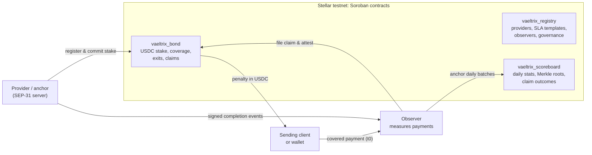

## What Vaeltrix is

Vaeltrix is an open protocol on Stellar where anchors and payment providers stake USDC against public, machine-readable payout-time agreements. When a covered SEP-31 payout breaches its agreement, the sender is paid an automatic penalty directly from that stake. Every outcome feeds a public reliability scoreboard per provider, corridor, and asset.

Stellar settles the onchain leg of a cross-border payment in seconds. The slow, failure-prone leg is the receiving anchor's offchain payout to a bank account or mobile money wallet. Vaeltrix makes offchain payout times measurable, comparable, and financially enforceable.

## How it works

1. **SLA commitments:** An anchor registers on the `vaeltrix_registry`, commits to a standard SLA template (e.g. 60-minute bank payout for USD -> PHP/BRL), and locks USDC stake in `vaeltrix_bond`.
2. **Measurement:** Covered payments start timing at the ledger close timestamp of the Stellar transaction (`t0_ms`). The payment finishes when the provider or recipient signs a completion receipt (`t1_ms`).
3. **Automated remedies:** If a payment completes late or never, a claim is filed. If uncontested, or if validated by independent observers, the penalty is paid directly to the sender.
4. **Public accountability:** Observers anchor daily batches with Merkle roots into `vaeltrix_scoreboard`, allowing anyone to verify provider uptime, p50/p95/p99 latency, and SLA compliance.

## Testnet deployment

The Vaeltrix contracts are live on Stellar testnet (Protocol 29):

- **`vaeltrix_registry`**: `CBBZQ577QYKADNBAYBYN56Q3ZDTDQYCBOGREHBFEVOWOI5F27TJBE6MO`
- **`vaeltrix_bond`**: `CCYLDMTA4CTFF2VHULUCCBNCBMN3G7MA33EZ2OFYMIRSIKX3PYUHCUAI`
- **`vaeltrix_scoreboard`**: `CD4TA5VDQUHF2LV5H5LWQSXRUSWTQYZN23MONYYUZQAJ5JBOEGYAP5EC`
- **Test USDC**: `CB2CFWENJ2M5JXWBGUOKO75QVIFJ2EY5WOIOHR6FFYTXAKGS2S3XOIM4`
- **Commitment 1:** 1,000 test USDC staked against SLA template 901.

All numbers in these docs and on the testnet playground represent testnet values. Never treat testnet tokens or addresses as mainnet assets.

## What is in these docs

- **[Contract reference](/docs/contract-reference)**: Generated directly from deployed testnet contracts and Rust types, with addresses, functions, types, and all 44 error codes.
- **[Concepts](/docs/concepts)**: Deep dive into commitments, measurement windows, carve-outs, claims, dispute resolution, and governance.
- **[Integration guides](/docs/integration-guides)**: Step-by-step guides for Payment Providers, Wallets/Clients, and Observers.
- **[SDK reference](/docs/sdk-reference)**: Using `@vaeltrix/core` and `@vaeltrix/sdk` for ID derivation, Canonical JSON (JCS), receipts, and verdicts.
- **[SLA templates](/docs/sla-templates)**: Structure of SLA templates, corridor scopes, penalty models, and Template 901.
- **[Running an observer](/docs/running-an-observer)**: Setting up a monitoring node, ledger watching, and daily batch anchoring.

## External links

- [Testnet Playground](https://vaeltrix-testnet.vercel.app): Interact with the deployed testnet contracts using Freighter.
- [Vaeltrix Website](https://www.vaeltrix.xyz): Protocol introduction and product overview.
- [GitHub Repository](https://github.com/Vaeltrix-SCF/vaeltrix-contracts): Open-source contracts, SDK, and service code.
