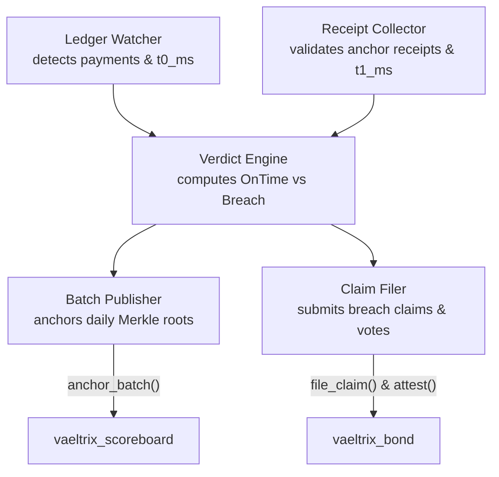

## Role of an observer

Observers are independent nodes that measure payment performance across Stellar anchors. They provide the offchain ground truth that powers onchain enforcement.

## Observer qualifications

- **Independence:** An observer address cannot be the admin of any registered provider. `vaeltrix_registry` rejects provider registrations from observer accounts and rejects observer additions for provider accounts.
- **Registration:** Observers are added through the registry governance timelock:
  1. The registry admin proposes `ActionKind::AddObserver(address, public_key)`.
  2. After `timelock_secs` elapses, `execute(action_id)` registers the observer.
  3. `is_active_observer(address)` returns `true`.

## Core responsibilities

### 1. Ingest payment starts (`t0_ms`)

Monitor the Stellar Horizon or RPC streaming endpoint for payments involving covered provider addresses. Extract:
- Transaction ledger close timestamp (`t0_ms`).
- Payment amount and currency.
- Provider ID and SEP-31 transaction ID.

### 2. Ingest completion receipts (`t1_ms`)

Receive signed completion receipts from the anchor via HTTP webhook or SEP-38/31 status poll:
- Validate that the receipt is 131 bytes.
- Verify the Ed25519 signature against the provider's registered signer keys in `vaeltrix_registry`.
- Extract `t1_ms` and any legitimate `pause_ms` carve-outs.

### 3. File automated claims

If a payment breaches its target duration plus grace, or if no completion receipt is provided before the claim window closes:
1. Verify that the payment was covered by checking `is_covered(commitment_id, t0_ms)` on `vaeltrix_bond`.
2. Construct the `PaymentRef` struct.
3. Call `bond.file_claim(...)` through an funded observer account.
4. If the provider challenges within `challenge_window_secs`, submit an attestation vote (`attest`) with the evidence hash.

### 4. Publish daily scoreboard batches

At 00:10 UTC each day, for each active commitment:
1. Select all payments with `t0_ms` within the previous UTC day `[period_start, period_start + 86400)`.
2. Calculate nearest-rank latency percentiles:
   - `p50_ms`: 50th percentile (median) payout latency.
   - `p95_ms`: 95th percentile payout latency.
   - `p99_ms`: 99th percentile payout latency.
3. Count total `payments`, `on_time`, `breaches`, and `carved_out`.
4. Construct a Merkle tree of all payment IDs and verdicts for the day.
5. Invoke `scoreboard.anchor_batch(...)` with the Merkle root and `PeriodStats`.
