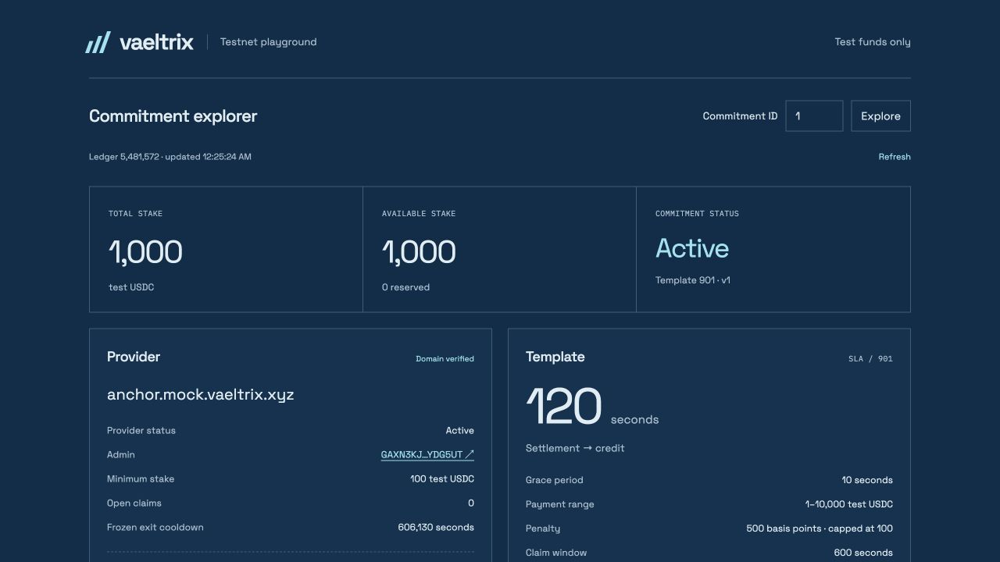
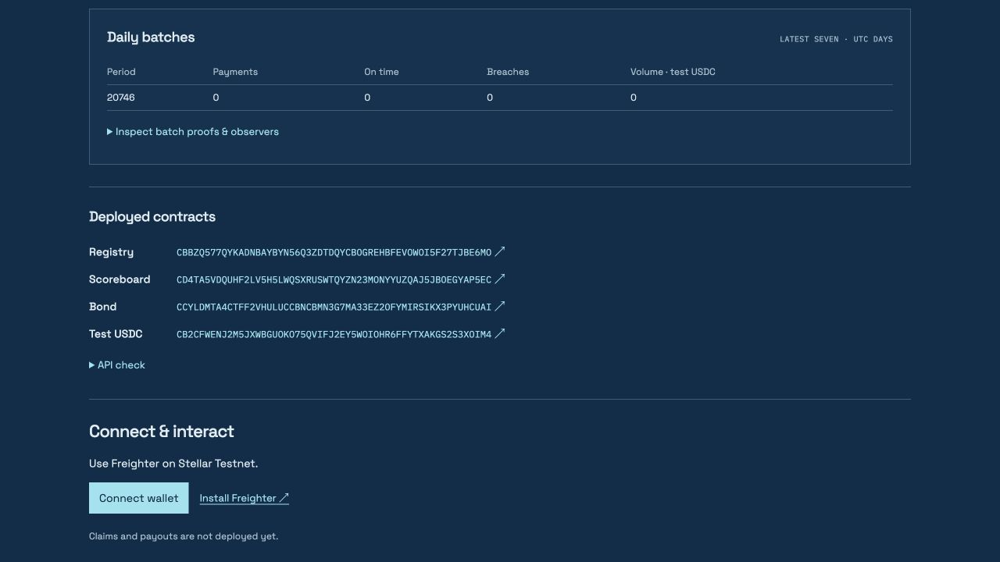
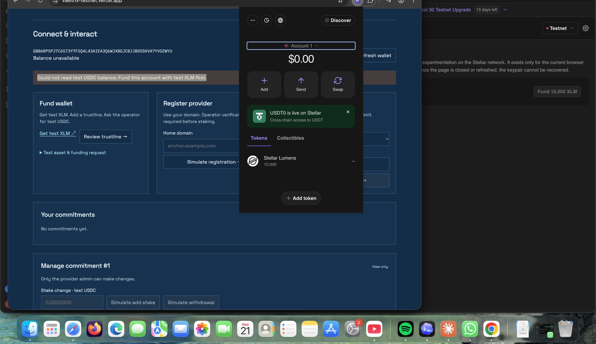

# UI/UX prototypes

The [live testnet playground](https://vaeltrix-testnet.vercel.app) is the current working prototype. It reads the deployed foundation; it is not a demonstration of automated claims or payouts. Follow the [tester walkthrough](../apps/playground/README.md#tester-walkthrough) for prerequisites and recovery.

## Public commitment explorer

Captured from the live Vercel playground during this documentation update. A visitor can look up commitment 1 without a wallet, inspect total/available stake, provider verification, template terms, daily batches and contract links. The capture shows 1,000 test USDC available and Active status; those are observed values, not a promise of future state. An empty batch does not prove completed payments.

## Connect a Testnet wallet

The live page offers Freighter connection on Stellar Testnet. Open it in the same browser/profile as the extension. The embedded preview browser cannot supply another browser's wallet extension. Connecting grants address access; signing remains a separate review step.

## Wallet funding and provider registration

Historical user-supplied capture from 21 October 2026, preserved without edited data. Freighter shows test XLM, while the playground offers trustline review and provider registration by home domain. The balance error visible in this historical capture is not evidence that test XLM funding failed: the app uses the same message for a failed USDC balance simulation before the deployment-specific trustline exists. This capture does not prove registration was submitted or provider verification completed.

Registration uses the connected wallet as admin and receipt signer. Publish the matching `stellar.toml` and request operator verification before committing stake. Never include seeds or private keys in documentation or screenshots.

## Commit stake: simulation and review

The implemented flow is: select a verified provider and template, enter test USDC, simulate, review signer/amount/network/fee/expiry, then explicitly sign in Freighter. A rejection must remain unsigned. See the [UI implementation](../apps/playground/src/main.tsx) and [transaction checks](../apps/playground/src/chain.ts).

A live connected-wallet capture of the commitment simulation/review is still required before this page satisfies the full prototype evidence checklist. No mock wallet state or fabricated transaction is substituted for it.

## Your commitments: manage stake and coverage

After confirmation, the owner's commitments expose add stake, withdraw excess, pause and resume. Each action requires a fresh simulation and review. Another wallet cannot operate seeded commitment 1. The frozen exit cooldown is displayed, but exit transactions are outside this UI.

A live owner-wallet capture of these controls is still required. Historical [commit/pause/resume transaction evidence](../test-net-deployment.md#onchain-activity) establishes those recorded operations, not screenshot coverage of every control or completed add/withdraw actions.

## Planned screens

Tranche 3's planned public explorer adds provider pages, corridor rankings, reliability scores and claim history. No Figma design or unbuilt screen is presented here as an existing prototype. Claims, challenges, payouts, payment tagging and observer automation remain outside the deployed playground.
